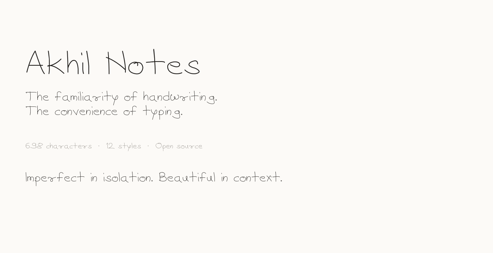
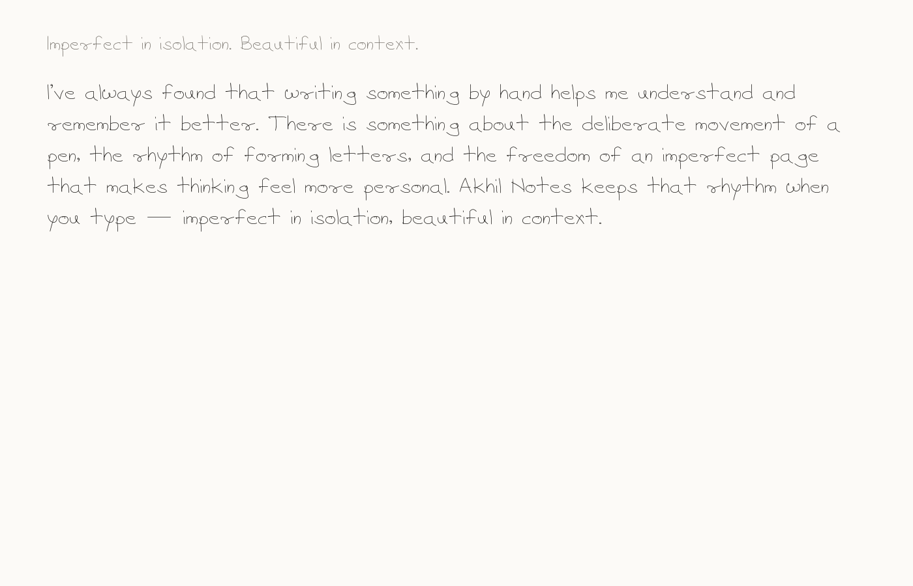
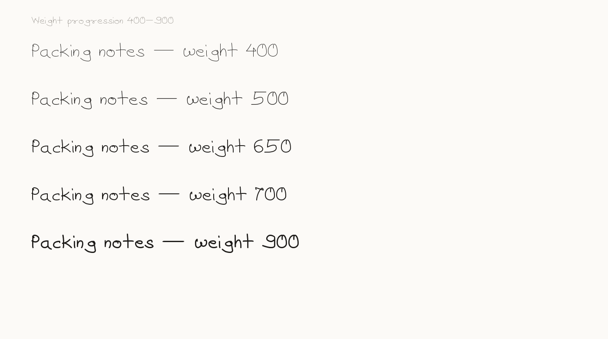
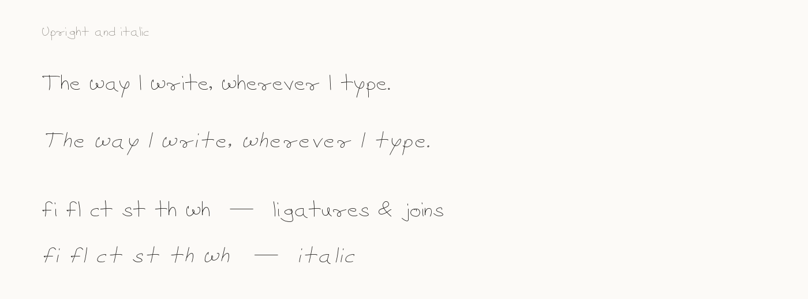
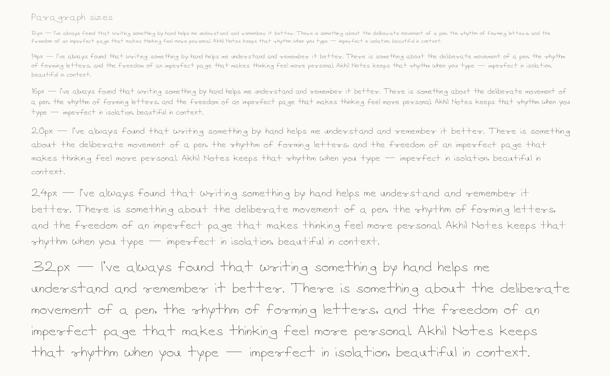
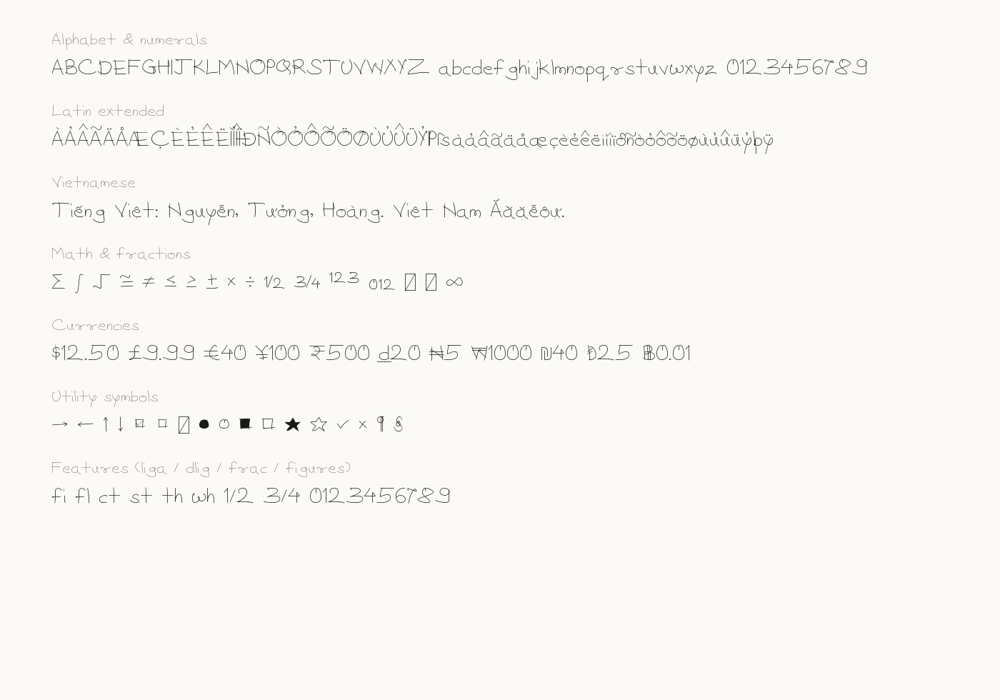
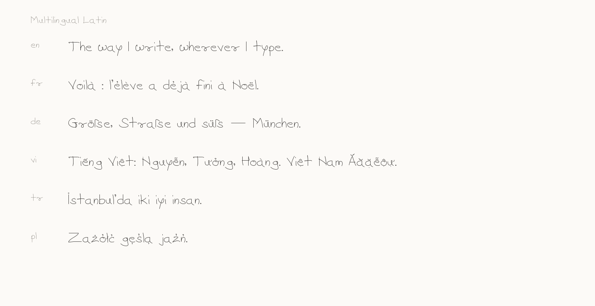
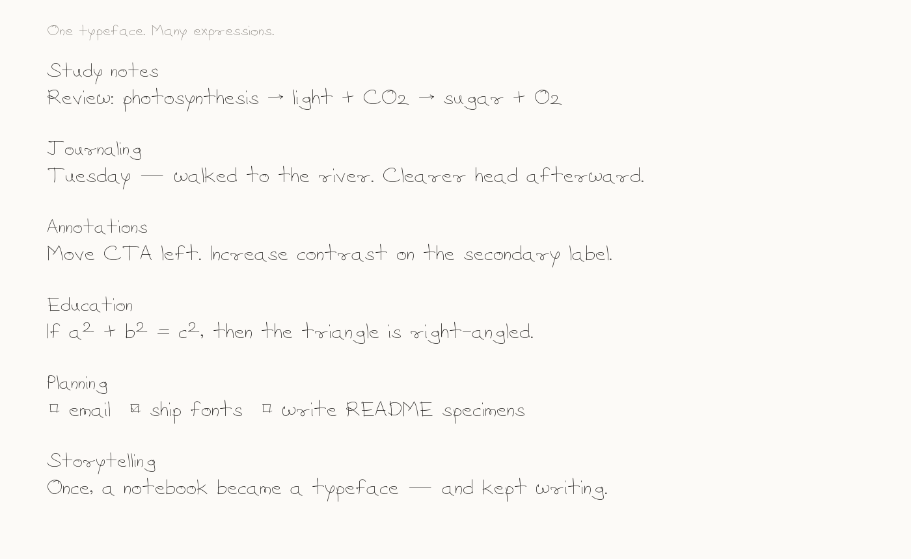
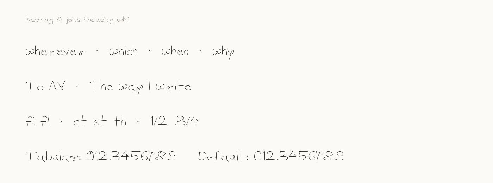
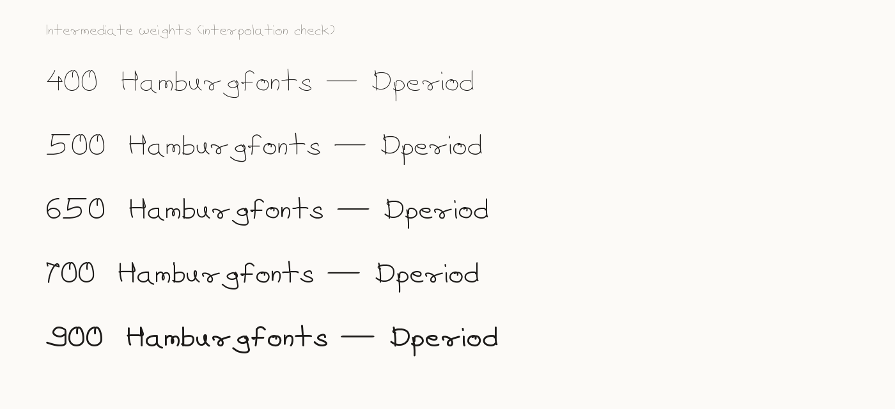

# Akhil Notes

[](https://github.com/akhildesai20/akhil-notes/actions/workflows/build.yml)
[](OFL.txt)

**The familiarity of handwriting. The convenience of typing.**

698 characters · 12 styles · Open source



---

## Download

| | |
| --- | --- |
| **Releases** (static TTFs, VF pair, WOFF2) | [github.com/akhildesai20/akhil-notes/releases](https://github.com/akhildesai20/akhil-notes/releases) |
| **Source** | [github.com/akhildesai20/akhil-notes](https://github.com/akhildesai20/akhil-notes) |
| **GF-style package** | [`ofl/akhilnotes/`](ofl/akhilnotes/) after build |

---

## Why it exists

I've always found that writing something by hand helps me understand and remember it better. There is something about the deliberate movement of a pen, the rhythm of forming letters, and the freedom of an imperfect page that makes thinking feel more personal.

As more work moved to digital tools, handwritten notes gradually gave way to keyboards. Akhil Notes began as a personal experiment to bring these two experiences a little closer together.

Rather than designing a typeface *inspired by* handwriting, I turned my own handwriting into one — starting from notebook pages, translating characters into vector outlines, and developing them into a functional family.

---

## Imperfect in isolation. Beautiful in context.

Individual characters often look irregular. Curves are not always symmetrical; proportions are not mathematically precise; strokes carry small inconsistencies. Yet in words, sentences and paragraphs they find a natural rhythm.

What appears imperfect in isolation becomes expressive in context. Akhil Notes preserves that personality on purpose.



---

## Family overview

| | |
| --- | --- |
| Designer | Akhil Desai |
| Classification | Handwriting |
| License | SIL Open Font License 1.1 |
| Encoded characters | 698 |
| Glyphs | 846 |
| Variable weight | 400–900 |
| Styles | Upright + italic variable fonts; 12 static instances |
| Coverage | GF Latin Core, Latin Plus, Vietnamese + math, currency, utility symbols |







---

## More than a decorative hand

Handwriting fonts are often reserved for greetings and display. Akhil Notes is also meant for working with information — notes, explanations, annotations and learning.





---

## One typeface. Many expressions.

Study notes · Journaling · Annotations · Education · Planning · Storytelling



These are suggested uses, not claims of adoption or learning outcomes.

---

## OpenType features

Kerning, discretionary joins (including **wh**), standard ligatures, mark / mkmk positioning, localized forms (e.g. Catalan, Turkish), fractions, and tabular numerals.





---

## Install

1. Download a [release](https://github.com/akhildesai20/akhil-notes/releases), or build from source (below).
2. **Windows:** select `.ttf` → right-click → Install.  
   **macOS:** double-click → Install Font.  
   **Linux:** copy into `~/.local/share/fonts/` and run `fc-cache -f`.

---

## Build (developers)

Public / CI build uses **committed UFO masters only** — no private fonts.

```powershell
py -3.12 -m venv .venv
.\.venv\Scripts\python.exe -m pip install -r requirements.txt
$env:PYTHONUTF8 = "1"
.\.venv\Scripts\python.exe scripts\build_candidate.py --from-ufo
```

Also: `sources/build.ps1` / `sources/build.sh`.

Fontspector is installed automatically when the overlap-flag hotfix needs it (`scripts/ensure_fontspector.py`).

| Output | Role |
| --- | --- |
| `ofl/akhilnotes/` | Shipping VF pair + metadata (tracked) |
| `fonts/ttf/` | Static instances (local / Releases; not git-tracked) |
| `documentation/specimens/` | Regenerated with `scripts/make_specimens.py` |

---

## Quality assurance

- OTS, instantiate, upright/italic parity: `scripts/audit_final.py`  
- HarfBuzz features: `scripts/qa_features.py`  
- Fontspector googlefonts profile on the VF pair: **FAIL 0**; remaining WARNs are intentional — see [`documentation/FONTSPECTOR-EXCEPTIONS.md`](documentation/FONTSPECTOR-EXCEPTIONS.md)  
- Status numbers: [`documentation/RELEASE-STATUS.md`](documentation/RELEASE-STATUS.md)  

Handwriting irregularities are not “bugs.” Optical approval and device testing remain human steps.

---

## License

SIL Open Font License 1.1 — see [OFL.txt](OFL.txt). Reserved Font Name: **Akhil Notes**.

Written by hand. Made for everyone.

---

## Links

- Designer: [Akhil Desai](https://www.instagram.com/akhilius_)  
- Source: https://github.com/akhildesai20/akhil-notes  
- Story & submission draft: [`documentation/ABOUT.md`](documentation/ABOUT.md), [`documentation/GF-SUBMISSION.md`](documentation/GF-SUBMISSION.md)  
